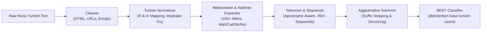

# 🇹🇷 Turkish NLP Toolkit (`turkish-nlp-toolkit`)

> **Production-Grade Turkish Text Preprocessing, Agglutinative Stemming, Logistics Address Standardization & BERT Transfer Learning Library**

[](https://github.com/ensibey/turkish-nlp-toolkit/actions)
[](https://www.python.org/)
[](https://huggingface.co/dbmdz/bert-base-turkish-cased)
[](https://opensource.org/licenses/MIT)

---

## 🎯 Overview

Turkish is a highly **agglutinative language** with strict vowel harmony, terminal consonant softening (`kitap → kitabın`), and special casing rules (`İ → i`, `I → ı`) that break standard English NLP tokenizers.

**`turkish-nlp-toolkit`** is a zero-bloat, modular Python library built around real-world Turkish NLP challenges—including algorithms developed during the **TEKNOFEST Hepsiburada Address Resolution Hackathon (Ranked 27th / 255 nationwide — Top 11%)**.

---

## 🏗️ Pipeline Architecture



---

## ⚡ Quick Start

### Installation
```bash
pip install turkish-nlp-toolkit

# With PyTorch & Hugging Face Transformers for BERT fine-tuning:
pip install "turkish-nlp-toolkit[bert]"
```

### 1. Fluent Preprocessing & Stemming Pipeline
```python
from turkish_nlp import Pipeline

pipe = (
    Pipeline()
    .clean(urls=True, emojis=True)
    .normalize(lowercase=True)
    .expand_abbreviations()
    .tokenize()
    .remove_stopwords()
    .stem()
)

tokens = pipe.run("Prof. Dr. Ayşe İstanbul'da kitaplarımızdan bahsetti! https://example.com")
print(tokens)
# -> ['profesör', 'doktor', 'ayşe', 'istanbul', 'kitap', 'bahsetti']
```

### 2. TEKNOFEST Logistics Address Standardization & Entity Extraction
```python
from turkish_nlp import address

raw_addr = "Ataturk Mah. Cumhuriyet Cad. Gul Sk. No: 12B Kat:3 D:8 Kadikoy/Istanbul"

print(address.standardize_address(raw_addr))
# -> "atatürk mahallesi cumhuriyet caddesi gul sokak no:12b kat:3 daire:8 kadıköy istanbul"

print(address.parse_address_components(raw_addr))
# -> {
#      'normalized': 'atatürk mahallesi cumhuriyet caddesi gul sokak no:12b kat:3 daire:8 kadıköy istanbul',
#      'mahalle': 'atatürk',
#      'cadde_bulvar': 'cumhuriyet',
#      'sokak': 'gul',
#      'bina_no': '12b',
#      'kat': '3',
#      'daire': '8'
#    }
```

### 3. Fine-Tuning Turkish BERT (`TurkishClassifier`)
```python
from turkish_nlp.bert import TurkishClassifier

clf = TurkishClassifier(
    num_labels=2,
    label_names=["negative", "positive"],
    model_name="dbmdz/bert-base-turkish-cased"
)

clf.train(
    texts=["Kargo çok hızlı geldi, paketleme harika!", "Ürün kırık çıktı, tavsiye etmem."],
    labels=[1, 0],
    epochs=3,
    batch_size=16
)

predictions = clf.predict(["Harika bir müşteri deneyimi!"])
# -> ['positive']
```

---

## 📦 Core Modules

| Module | Description |
| :--- | :--- |
| `turkish_nlp.normalizer` | Correct Turkish `İ→i` and `I→ı` lowercasing/uppercasing, Unicode NFC normalization, and UTF-8 mojibake repair (`ü → ü`). |
| `turkish_nlp.abbreviations` | Expands 150+ academic, administrative, medical, and organizational Turkish abbreviations (`Prof.`, `Dr.`, `Mah.`, `Tic.`, `Ltd.`). |
| `turkish_nlp.address` | Standardizes noisy postal addresses and extracts structured `mahalle`, `cadde`, `sokak`, `bina_no`, `kat`, `daire` fields. |
| `turkish_nlp.stemmer` | Rule-based agglutinative suffix stripper with consonant softening recovery (`kitabın → kitap`). |
| `turkish_nlp.tokenizer` | Sentence and word tokenizer preserving Turkish apostrophe inflection (`İstanbul'da`). |
| `turkish_nlp.stopwords` | Curated 350+ Turkish function words and discourse particles with custom allow/deny lists. |
| `turkish_nlp.bert` | High-level PyTorch + Hugging Face trainer and evaluator for `dbmdz/bert-base-turkish-cased`. |

---

## 🧪 Running Tests

```bash
pytest -v tests/
```

## 📄 License
MIT © Enis Doğan
